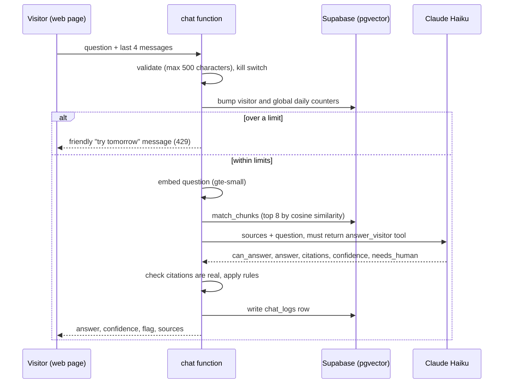
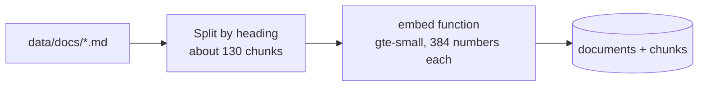

# Workflow diagrams

## One question, end to end

## Loading documents

Re-running `npm run ingest` replaces everything, so it is safe to repeat.

## Error and fallback paths

| What goes wrong | What the visitor sees | What is logged |
|---|---|---|
| Claude is down or returns junk | "I could not produce a reliable answer. A consultant can help." | Abstained, zero cost |
| Nothing in the documents is close | "I don't know" without any Claude call | Abstained, zero cost |
| Answer cites a passage that was not retrieved | "I don't know" | Abstained |
| Visitor or global daily limit reached | Friendly limit message | Nothing |
| Logging fails | Normal answer | Nothing (answer is never blocked by logging) |
| Kill switch `CHAT_ENABLED=false` | "The demo is paused" | Nothing |

Manual fallback: if the chat is paused or down, the page shows the firm's phone number and email.
